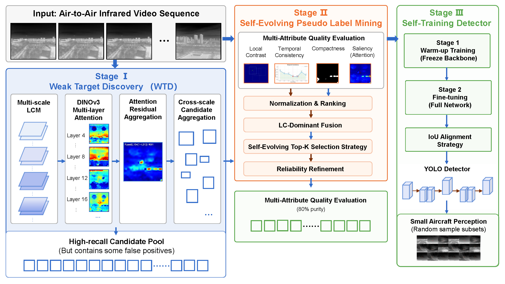
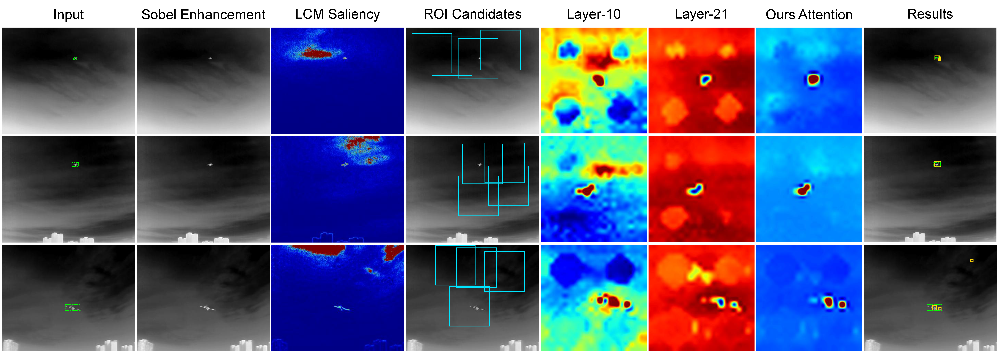
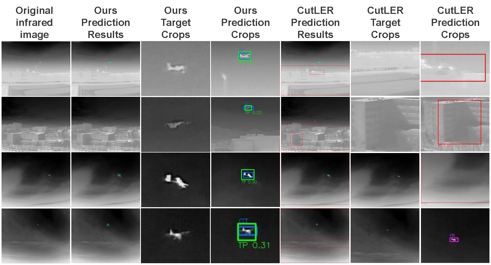

# SELD — Self-Evolving Learning for Annotation-Free Infrared Small Aircraft Perception

Reference implementation of the three-stage SELD pipeline: weak-target discovery
from unlabelled infrared frames, pseudo-label mining by multi-cue scoring, and
two-stage detector self-training.

Datasets and mined candidate pools are not included: every path is resolved
from `configs/default.yaml`. Checkpoint files are described in
`models/trained_weights/README.md`.

```
seld-main/
├── configs/default.yaml       # single source of truth for paths and hyper-parameters
├── models/
│   ├── __init__.py            # configuration loader
│   ├── WTD/                   # Stage 1 — LCM proposals and DINOv3 attention
│   ├── SELD/                  # Stage 2 scoring / pseudo labels, Stage 3 self-training
│   └── trained_weights/       # checkpoint files, see its README
├── datasets/README.md         # expected dataset layout
├── docs/images/               # pipeline and intermediate figure placeholders
├── tools/
│   ├── weak_target_discovery.py
│   ├── pseudo_label_mining.py
│   └── evaluation.py
├── scripts/
│   ├── run_wtd.sh
│   ├── generate_pseudo_labels.sh
│   └── train_detector.sh
├── requirements.txt
└── LICENSE
```

## Method overview

SELD turns an unlabelled infrared sequence set into a real-time detector through
three coupled stages: discovery, refinement and self-training.


Overview of the three-stage SELD pipeline, from unlabelled infrared frames to a self-trained detector.

### Stage 1 — Weak-target discovery (WTD)

Multi-scale local contrast measurement (LCM) is computed at scales 3, 5 and 7,
and the per-pixel maximum `L = max_r L_r` is kept as the saliency map. The four
strongest local peaks of `L` become ROI centres, and a 384×384 patch is cropped
around each centre. Every patch is passed through the DINOv3 ViT-L/16 backbone
and the attention maps of layer 10 and layer 21 are recorded. The residual
fusion

```
M = A10 ⊙ (1 − A21)
```

suppresses the broad, semantically deep responses while keeping the sharp
mid-layer response of small targets. Each fused map is upsampled to the ROI
resolution and filtered by strict morphology (area, compactness, aspect ratio,
border penalty), followed by global NMS across ROIs and confirmation by
trajectory continuity over consecutive frames.


Intermediate products of Stage 1: the LCM saliency map, the four selected ROIs, the layer-10 and layer-21 attention maps, and the fused response `M = A10 ⊙ (1 − A21)` of a small target.


Qualitative results of the three-stage SELD pipeline on targets of different scales, from a 33x16 target against cloud background to a 154x58 target against urban clutter.

### Stage 2 — Pseudo-label mining

Every confirmed candidate carries a temporal consistency `T_i` and a local
contrast `LC_i`. Both are min-max normalised over the candidate pool, and the
mining score is

```
F_i = LC_i · (1 + w_T · T_i)
```

Candidates are sorted by `F_i`, and the top `ρ` fraction becomes the pseudo-label
set `D_p`, exported in YOLO format with a COCO-extended annotation file.

### Stage 3 — Two-stage self-training

A YOLOv11-s detector is trained on the fixed pseudo-label set `D_p`. The first
stage freezes the backbone and optimises the detection head only; the second
stage unfreezes the whole network and jointly optimises all parameters. `D_p` is
never refreshed from the detector's own predictions.

## Environment

Reference environment (the versions the code was validated against):

```
Python 3.11, CUDA 12.4
torch 2.6.0+cu124   torchvision 0.21.0+cu124   ultralytics 8.4.75
opencv-python 4.13.0   numpy 2.4.6   scipy 1.17.1
pillow 12.2.0   PyYAML 6.0.3   safetensors 0.8.0
```

```bash
pip install -r requirements.txt
```

Stage 1 loads the DINOv3 ViT-L/16 backbone from the official
[`facebookresearch/dinov3`](https://github.com/facebookresearch/dinov3) code base.
Either install it in the active environment, or set `dinov3_repo` in
`configs/default.yaml` to the cloned source tree; the loader inserts that
directory into `sys.path` before importing `dinov3.models.vision_transformer`.

## Data preparation

See [`datasets/README.md`](datasets/README.md) for the expected MMFW-UAV layout,
the annotation format and the sequence naming convention. Set `data_root` in
`configs/default.yaml` accordingly; `split_dir`, `image_dir` and
`annotation_dir` define the per-sequence sub-directory names.

## Model weights

All checkpoints live in `models/trained_weights/`; see
[`models/trained_weights/README.md`](models/trained_weights/README.md) for the
exact file names and their sources.

| File | Role | Source |
|---|---|---|
| `dinov3-vitl16-pretrain-lvd1689m/model.safetensors` | Stage 1 backbone | DINOv3 ViT-L/16, LVD-1689M |
| `yolo11s.pt` | Stage 3 initialisation | Ultralytics YOLOv11-s, COCO |
| `seld_yolo11s.pt` | Stage 3 output | produced by `scripts/train_detector.sh` |

## Usage

All entry points read `configs/default.yaml` and can be run from the repository
root. Every script exposes `--help`.

Stage 1 — mine the candidate pool:

```bash
PYTHON=/path/to/python bash scripts/run_wtd.sh
# python tools/weak_target_discovery.py
```

Stage 2 — score the pool and export `D_p`:

```bash
PYTHON=/path/to/python bash scripts/generate_pseudo_labels.sh
# python tools/pseudo_label_mining.py
```

Stage 3 — two-stage self-training:

```bash
PYTHON=/path/to/python bash scripts/train_detector.sh
```

The candidate pool is written to `candidates` (`./outputs/all_candidates.json` by
default), the pseudo-label dataset to `pseudo_dataset`
(`./outputs/pseudouavdata`), and the trained detector to `final_weights`
(`./models/trained_weights/seld_yolo11s.pt`).

## Evaluation

Proposals are evaluated at an IoU threshold of 0.15:

* **Recall** — GT-level: number of ground-truth targets matched by at least one
  proposal, divided by the total number of ground-truth targets;
* **Mean IoU** — averaged over frames whose best IoU is greater than zero;
* **FPS** — number of evaluated frames divided by the elapsed time;
* **Avg. proposals** — total number of proposals divided by the number of frames.

```bash
python tools/evaluation.py --method wtd
python tools/evaluation.py --method yolo --weights models/trained_weights/seld_yolo11s.pt
```

| Stage | Data | Recall (%) | Precision (%) | F1 (%) | AP@50 (%) | Mean IoU | FPS | Props/frame | Params (M) | FLOPs (G) |
|---|---|---|---|---|---|---|---|---|---|---|
| Stage 1 (WTD) | 16009 (all) | 68.09 | -- | 33.08 | -- | 0.4550 | 6.3 | 3.28 | 303.11 | 704.27 |
| Stage 3 (SELD) | 16009 (all) | 92.65 | 81.63 | 86.79 | 44.80 | -- | 129.5 | 1.14 | 9.4 | 85.2 |

Stage 1 is evaluated at the ground-truth level on all 16009 frames and does not
produce precision, F1 or AP@50. Stage 3 is evaluated at the detection level.

## Data

Experiments use four public infrared datasets: **MMFW-UAV** for training and
evaluation, and **Anti-UAV410**, **CST Anti-UAV** and **IRDST** for cross-dataset
evaluation. None of them is redistributed with this repository. Their layout,
annotation format and licence terms are described in
[`datasets/README.md`](datasets/README.md).

## Citation

If you use this code or the derived checkpoints, please cite:

```bibtex
@article{seld2026,
  title  = {Self-Evolving Learning for Annotation-Free Infrared Small Aircraft Perception},
  author = {SELD Authors},
  year   = {2026}
}

@article{liu2025mmfw,
  title   = {MMFW-UAV dataset: multi-sensor and multi-view fixed-wing UAV dataset for air-to-air vision tasks},
  author  = {Liu, Yang and Sun, Zhihao and Xi, Lele and Zhang, Lele and Dong, Wei and Chen, Chen and Lu, Maobin and Fu, Hailing and Deng, Fang},
  journal = {Scientific Data},
  volume  = {12},
  pages   = {185},
  year    = {2025},
  doi     = {10.1038/s41597-025-04482-2}
}

@article{huang2023anti,
  title   = {Anti-UAV410: A thermal infrared benchmark and customized scheme for tracking drones in the wild},
  author  = {Huang, Bo and Li, Jianan and Chen, Junjie and Wang, Gang and Zhao, Jian and Xu, Tingfa},
  journal = {IEEE Transactions on Pattern Analysis and Machine Intelligence},
  volume  = {46},
  number  = {5},
  pages   = {2852--2865},
  year    = {2023}
}

@inproceedings{xie2025cst,
  title     = {CST Anti-UAV: A thermal infrared benchmark for tiny UAV tracking in complex scenes},
  author    = {Xie, Bin and Zhang, Congxuan and Wang, Fagan and Liu, Peng and Lu, Feng and Chen, Zhen and Hu, Weiming},
  booktitle = {IEEE/CVF International Conference on Computer Vision Workshops (ICCVW)},
  pages     = {6216--6225},
  year      = {2025}
}

@article{sun2023receptive,
  title   = {Receptive-field and direction induced attention network for infrared dim small target detection with a large-scale dataset IRDST},
  author  = {Sun, Heng and Bai, Junxiang and Yang, Fan and Bai, Xiangzhi},
  journal = {IEEE Transactions on Geoscience and Remote Sensing},
  volume  = {61},
  pages   = {1--13},
  year    = {2023}
}
```

## Licence

The source code, the released checkpoints and the accompanying documentation
are released under the Creative Commons Attribution-NonCommercial-NoDerivatives
4.0 International licence (see [`LICENSE`](LICENSE)). The datasets are
distributed by their original authors under their own terms and are not
redistributed here.
